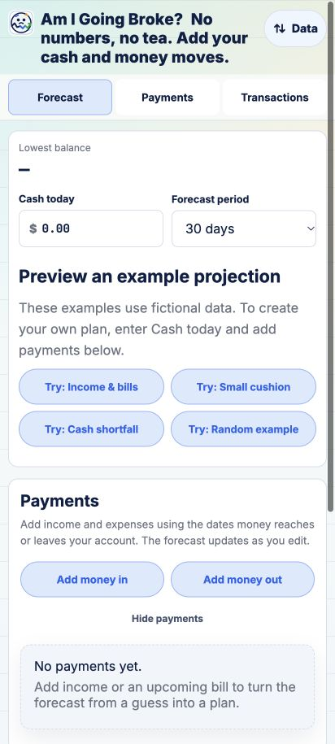
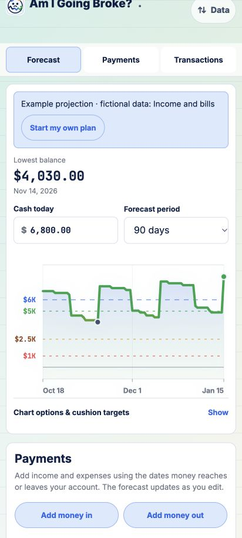
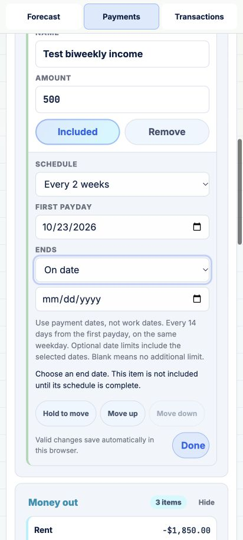
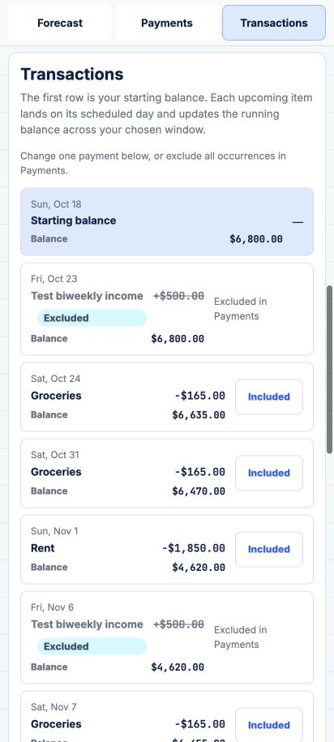
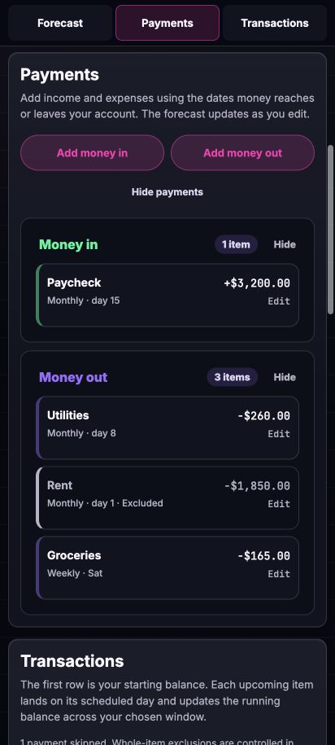
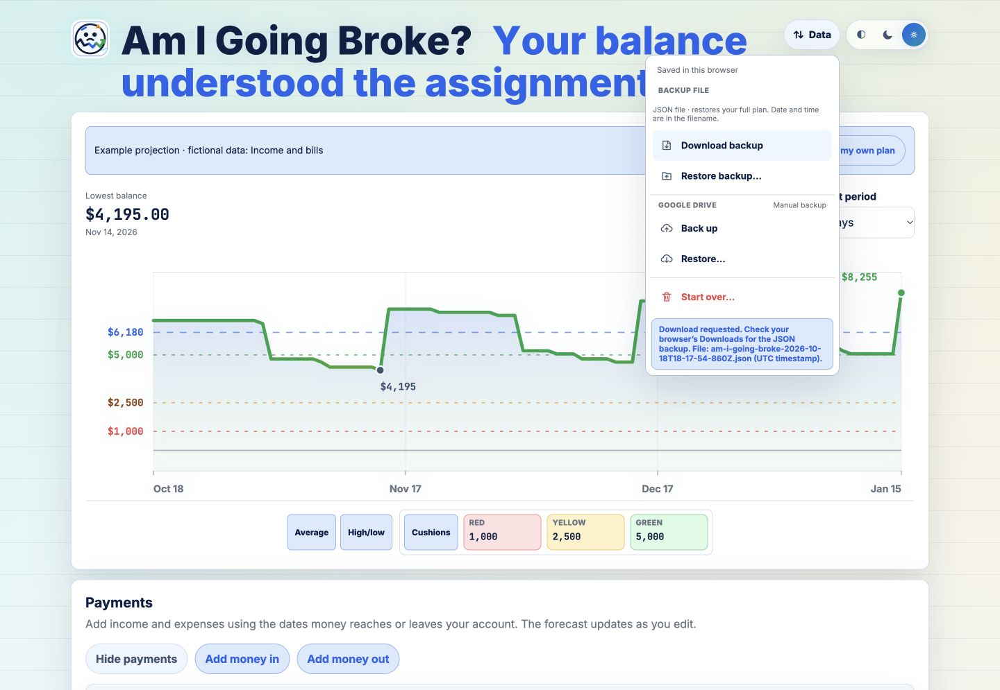
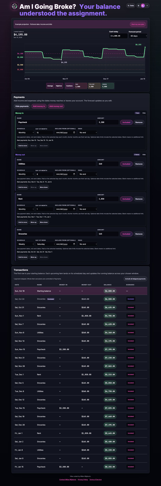
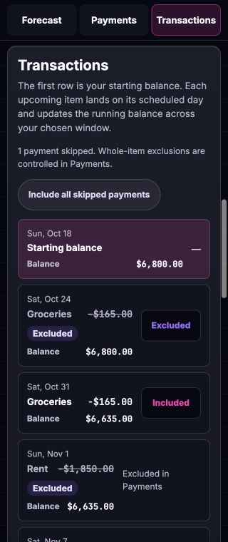

# Payment usability release — October 18, 2026

## Implemented scope

| Issue | Result |
| --- | --- |
| [#28](https://github.com/vibe-coding-milan/am-i-going-broke/issues/28) | Explicit fictional-example entry, persistent sample banner, and Start my own plan with confirmation. |
| [#29](https://github.com/vibe-coding-milan/am-i-going-broke/issues/29) | First payday/payment date for biweekly recurrence, no redundant optional start for new biweekly items, next-payment preview, and weekly/monthly explanations. Legacy distinct inclusion limits remain editable. |
| [#30](https://github.com/vibe-coding-milan/am-i-going-broke/issues/30) | Optional starts are blank on new items; end dates never fall back to today. Choosing a mode that needs an empty required date makes the item visibly incomplete until supplied or switched back to No end. Blank drafts survive reload and backup restoration. |
| [#31](https://github.com/vibe-coding-milan/am-i-going-broke/issues/31) | Immediate Undo remains; later meaningful mutations or forecast refresh clear it. Explicit Dismiss is available. Undo is session-local and absent after browser reload. No short timeout is imposed. |
| [#32](https://github.com/vibe-coding-milan/am-i-going-broke/issues/32) | Edit an item to use Move up/down or its dedicated Hold to move handle. Pointer drag stays within the direction; touch activation waits 350ms. Button controls support keyboard and non-drag use. Order survives reload and backups. |
| [#33](https://github.com/vibe-coding-milan/am-i-going-broke/issues/33) | Excluded items remain in Payments and otherwise scheduled transaction rows. Labels, muted appearance, and reference-amount strikethrough communicate exclusion without affecting balances. Parent exclusion and individual skips retain distinct scope. |
| [#34](https://github.com/vibe-coding-milan/am-i-going-broke/issues/34) | Download URL survives for 60 seconds; detectable initiation failures are handled. Persistent feedback says Download requested, directs users to Downloads, and is no longer hidden by the generated link closing the Data menu. Device/blocker investigation stays open. |
| [#35](https://github.com/vibe-coding-milan/am-i-going-broke/issues/35) | One export instant supplies filename and JSON metadata. Filenames use UTC with milliseconds and Z; restore previews show local date/time with timezone. |

Additional polish: consistent Payments labels, readable Included/Excluded transaction controls, singular/plural skip count, Include all skipped payments with explicit scope, opening balance outside Money in, and focus/scroll restoration keyed to the actual control or transaction.

## Data and calculation guarantees

Existing valid dates are not cleared or moved. Older count-limited rules retain their original normalization anchor. New incomplete schedules explicitly retain their draft state; biweekly count limits use the first payment date when no separate eligibility start exists.

Manual arrangement changes the rule list, while a persisted calculationOrder preserves same-day calculation order and forecast values. Normalization supplies that order for existing plans; new rules receive the next sequence. Additional metadata is compatible with the current JSON backup envelope.

Whole-item exclusions still enumerate scheduled dates for display, including recurrence and limits. Their contributions are zero, and single-occurrence exclusions survive switching the parent back on. The current opening balance is displayed once and is not labeled as an incoming transaction.

## Verification

- Project checker: syntax and local HTML/Markdown links; 33 tests in America/New_York and Pacific/Auckland (66 passes).
- New model coverage: excluded recurring/count-limited and one-time items, independent skips, incomplete schedules, blank-date reloads, legacy count anchors, stable same-day calculations after reorder/restore, and opening balance semantics.
- Download coverage: actual browser JSON file generation and restore; matching timestamped filename and exportedAt; delayed URL release; simulated detectable URL-creation failure with unchanged plan.
- UI checks: 412px phone and 1440px desktop, light/dark appearance, plus 320px dark transaction layout with no horizontal overflow. The narrow-screen check caught and corrected exclusion badges breaking into letters.
- End-mode control stayed at approximately 436px from the viewport top before/after rerender (under 1px difference), replacing the prior jump to Forecast.
- Verified immediate Undo, expiry after another addition and forecast refresh, and absence after reload.
- Verified Move up persistence and desktop pointer drag within Money out; downloaded/restored plan retained manual order and the same $4,195 minimum in the tested fictional scenario.

## Captured checks

1. First-time entry — clear fictional-example choices. 
2. Example loaded — persistent banner and personal-plan action, including after reload. 
3. Biweekly editor — one first payday, blank end date, explicit pending state, and move controls. 
4. Transactions — excluded parent occurrences remain visible with unchanged balances. 
5. Payment list — saved manual order and excluded item treatment. 
6. Download — persistent initiation feedback and timestamped file. 
7. Desktop — reordered expenses, weekly/monthly previews, and transaction states in dark appearance. 
8. Narrow phone — readable exclusion labels and controls at 320px. 

## Remaining validation

The in-app browser is not a physical Pixel 7. Native date pickers/keyboards, touch long-press behavior, screen-reader announcements, browser background/restore behavior, and actual ad-blocker/filter combinations require device testing. Track these in #25 and #34. No independent evidence identifies an ad blocker, low battery, or network issue as the cause of the original delayed/discovered-later download.

No automatic sorting, continuous synchronization, spreadsheet export, or unrelated exploratory backlog features are included.
